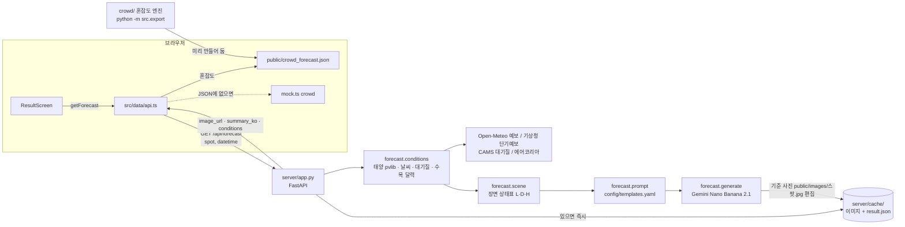

2026년도 공공데이터 활용 경진대회

# 올팍 포토캐스트

올림픽공원 포토 스팟을 고르고 날짜·시간을 정하면, 그때의 **예상 배경 이미지**와 **혼잡도**를 보여 준다.

- 프론트엔드: Vite + React + TS (`src/`)
- AI 예상 이미지 서버: FastAPI + forecast 패키지 + Gemini 이미지 편집 (`server/`)
- 혼잡도 엔진: Python, 공공데이터로 만든 정적 JSON (`crowd/` → `public/crowd_forecast.json`)
- 서버 없이도 프론트는 돈다(자리표시 이미지). 혼잡도는 엔진 JSON을 읽고, JSON에 없는 날짜·스팟만 `src/data/mock.ts`의 계산을 쓴다.

## 구조



API 실패·하루 한도 초과면 프론트는 자리표시 이미지를 보여 주고 사유를 안내문에 띄운다.

## 실행

### 1) 서버

```bash
cd olpark_photocast
python3 -m venv server/.venv
server/.venv/bin/pip install -r server/requirements.txt

# 키 설정: server/.env (커밋 금지, .gitignore에 있음)
# (주석은 줄 끝이 아니라 따로 한 줄로 — 줄 끝에 쓰면 값에 섞인다)
cat > server/.env <<'EOF'
# Google AI Studio에서 발급
GEMINI_API_KEY=...
# (선택) 공공데이터포털 기상청 단기예보 조회서비스 / 에어코리아 대기오염정보
KMA_SERVICE_KEY=
AIRKOREA_SERVICE_KEY=
# 하루 최대 생성 장수 (넘으면 429)
DAILY_LIMIT=30
# 프롬프트 실험실: 공용 비밀번호, 사용자 이름(쉼표), 사람당 하루 생성 수
LAB_PASSCODE=...
LAB_USERS=세환,친구
LAB_DAILY_LIMIT=20        # 0 = 제한 없음
EOF
chmod 600 server/.env

server/.venv/bin/uvicorn server.app:app --reload --port 8000
# 확인: curl http://localhost:8000/api/health
```

- `GET /api/forecast?spot=naholo&datetime=2026-11-22T12:00` (한국 시간, 정시, 오늘~7일 뒤)
- 생성에 10~20초, 장당 약 $0.034. 같은 (스팟, 시각, 템플릿 버전, 모델)은 `server/cache/`에서 즉시 반환하고 다시 만들지 않는다.
- 같은 요청이 동시에 와도 한 번만 생성한다.
- 선택 키가 없으면 Open-Meteo(예보·대기질)로 대신한다.

### 2) 프론트

```bash
npm install
cp .env.example .env.local     # VITE_API_BASE= (빈 값 → 개발 서버 프록시 /api → localhost:8000)
npm run dev                    # http://localhost:5173
```

- `.env.local`이 없으면(VITE_API_BASE 미설정) 서버를 부르지 않고 예전처럼 자리표시 이미지만 쓴다.
- 배포 시에는 `VITE_API_BASE=https://<서버 주소>`로 빌드한다(`npm run build`). 서버 CORS는 지금 localhost:5173만 허용하므로 배포 주소를 `server/app.py`에 추가해야 한다.

### 3) 혼잡도 엔진 (`crowd/`)

혼잡도 점수는 서버가 아니라 미리 만든 정적 JSON이다. 프론트만 띄워도 `public/crowd_forecast.json`을 읽어 바로 나온다. 엔진은 공연 일정이나 스팟 설정을 바꿀 때만 다시 돌린다.

- 데이터: 한국체육산업개발 「올림픽공원 2025 차량입출차, 공연, 날씨정보 등 연계 데이터」 (KCISA API_CPM_009)
- 방식: 2025년 주차 데이터로 (평일 / 주말·공휴일 / 명절) × 시간 평균과 공연 관람객 효과를 잰다. 미래 날짜·공연에 적용해 0~100점, 4단계 등급(30/75/85), 근거 문구를 만든다.
- 범위: 2026-12-01 ~ 2027-02-28, 06~22시
- 웹 연결: `src/data/api.ts`가 (스팟 id, 시각)으로 JSON을 찾는다. 등급 경계는 `src/data/types.ts`의 `CROWD_LEVELS`와 엔진이 같은 값을 쓴다.
- 실행 방법·설정 파일·한계: **[crowd/README.md](crowd/README.md)**

## 스팟 설정

`server/forecast/spots/{rose,wild,gyeong4,naholo}.yaml` — 좌표·카메라 방위는 2026-11-22 현장 실측, 화각은 아이폰 1x 세로(50°/65°).
기준 시각은 기준 사진 EXIF, 기준 날씨는 그 시각의 실제 값(Open-Meteo). 수목 단계는 `server/forecast/config/phenology.yaml`(11/22 관찰로 보정).
4경 이름은 확정 전(임시 '4경'). 프롬프트 문장은 `server/forecast/config/templates.yaml`, 판단 규칙은 `rules.yaml`·`delta_rules.yaml`.

## 프롬프트 실험실

두 사람이 프롬프트 템플릿을 fork해 고쳐 보며 결과 이미지를 비교하는 곳. 사용법은 **[LAB_GUIDE.md](LAB_GUIDE.md)**.

- 화면: `#/lab` (`src/lab/`, 공개 화면과 따로 불러옴). 탭: 실험 · 기록 · 그리드 · 실제 사진
- API: `server/lab/` (`/api/lab/...`). 입장 = 공용 비밀번호 `LAB_PASSCODE` + 사용자 `LAB_USERS`
- 저장: `server/lab.db`(SQLite) + `server/lab_data/`(생성 이미지 JPEG 90·긴 변 1536, 실제 사진, 비교 패널) — 커밋 안 함
- 기본 모델 Nano Banana 2.1(`gemini-nano-banana-2.1`, 장당 $0.034, 모델 v1부터). Pro(장당 $0.134)는 실험실에서 고를 수 있다. 사용자별 하루 20장(`LAB_DAILY_LIMIT`)
- 공개 화면 예측은 현재 shared 템플릿 + 아래 기준 사진을 쓴다. 공개 캐시 키에 모델 id와 기준 사진 해시가 들어간다.
- 같이 쓰기: `bash scripts/start_lab.sh` → Cloudflare quick tunnel 주소를 친구에게 (처음 한 번 `bash scripts/install_cloudflared.sh`)

### 나중에 클라우드(Cloud Run + Cloud Storage)로 옮길 때 바꿀 부분 (지금은 옮기지 않음)

| 지금 (맥 + 터널) | 클라우드 | 바꿀 곳 |
|---|---|---|
| `server/lab.db` SQLite 파일 | Cloud Run은 디스크가 휘발성 → **Cloud SQL(PostgreSQL)** 또는 Firestore | `server/lab/db.py` (연결·SQL 방언: `ON CONFLICT`, `AUTOINCREMENT`) |
| `server/lab_data/`, `server/cache/` 로컬 파일 | **Cloud Storage 버킷** (images/, real/, panels/, public-cache/) | `core.save_jpeg`, `store_real`, `score_against_real`, `app.py`의 캐시 읽기·쓰기 → GCS 클라이언트. 이미지는 서명 URL로 내주기 |
| `server/.env`의 키·비밀번호 | **Secret Manager** → Cloud Run 환경변수로 주입 | `forecast/common.load_env`는 그대로(환경변수 우선) |
| `server/.lab_secret` 파일 | `LAB_SECRET` 환경변수(Secret Manager) — 인스턴스가 여러 개여도 같은 쿠키 서명 | 설정만 |
| 프로세스 메모리의 잠금·그리드 작업 상태(`_jobs`, `_key_locks`) | 인스턴스가 여러 개면 공유 안 됨 → 최대 인스턴스 1로 시작하거나, 작업 상태를 DB에, 그리드는 **Cloud Tasks** | `core.grid_run`, `grid_job` |
| 하루 사용량(`usage` 표, `cache/usage.json`) | DB 한 곳으로 통일 | `app.py` 공개 사용량 → DB |
| Open-Meteo 응답 캐시 `server/outputs/forecast/cache` | /tmp(인스턴스 수명) 또는 GCS | `forecast/common.http_json` |
| `dist/`를 FastAPI가 내줌 | 그대로 같은 컨테이너에 넣거나, 정적 파일은 Firebase Hosting/버킷 | Dockerfile에서 `npm run build` 후 복사 |
| CORS localhost만 | 배포 도메인 추가, 쿠키 `secure=True` | `app.py`, `lab/routes.py` 로그인 쿠키 |
| 요청 시간 | 생성 15~20초 → Cloud Run 요청 타임아웃 기본 300초면 충분. 그리드는 백그라운드 작업으로 | |

## 기준 사진 (2026-11-22 답사)

`server/base_photos/{rose,wild,gyeong4,naholo}.jpg` — 아이폰 원본에서 만든 전송용 사본(긴 변 1536px, 촬영 시각 EXIF만 남기고 GPS 제거).
원본을 새로 찍으면 `~/skyfinder/basephotos/`에 넣고 `server/.venv/bin/python -u scripts/import_basephotos.py` (촬영 순서 9경·8경·4경·6경).
스팟 좌표·방위는 `server/forecast/spots/*.yaml` (현장 실측).
