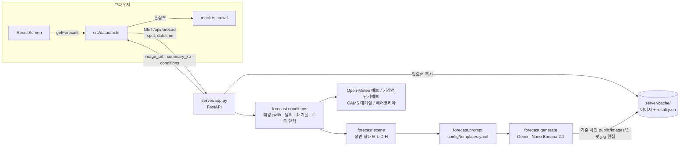

2026년도 공공데이터 활용 경진대회

# 올팍 포토캐스트

올림픽공원 포토 스팟을 고르고 날짜·시간을 정하면, 그때의 **예상 배경 이미지**와 **혼잡도**를 보여 준다.

- 프론트엔드: Vite + React + TS (`src/`)
- AI 예상 이미지 서버: FastAPI + forecast 패키지 + Gemini 이미지 편집 (`server/`)
- 서버 없이도 프론트는 돈다(자리표시 이미지). 혼잡도는 아직 `src/data/mock.ts`의 계산을 쓴다.

## 구조



API 실패·하루 한도 초과면 프론트는 자리표시 이미지를 보여 주고 사유를 안내문에 띄운다.

## 실행

### 1) 서버

```bash
cd olpark_photocast
python3 -m venv server/.venv
server/.venv/bin/pip install -r server/requirements.txt

# 키 설정: server/.env (커밋 금지, .gitignore에 있음)
# (주석은 줄 끝이 아니라 따로 한 줄로 — 줄 끝에 쓰면 값에 섞인다)
cat > server/.env <<'EOF'
# Google AI Studio에서 발급
GEMINI_API_KEY=...
# (선택) 공공데이터포털 기상청 단기예보 조회서비스 / 에어코리아 대기오염정보
KMA_SERVICE_KEY=
AIRKOREA_SERVICE_KEY=
# 하루 최대 생성 장수 (넘으면 429)
DAILY_LIMIT=30
EOF
chmod 600 server/.env

server/.venv/bin/uvicorn server.app:app --reload --port 8000
# 확인: curl http://localhost:8000/api/health
```

- `GET /api/forecast?spot=naholo&datetime=2026-11-22T12:00` (한국 시간, 정시, 오늘~7일 뒤)
- 생성에 10~20초, 장당 약 $0.034. 같은 (스팟, 시각, 템플릿 버전, 모델)은 `server/cache/`에서 즉시 반환하고 다시 만들지 않는다.
- 같은 요청이 동시에 와도 한 번만 생성한다.
- 선택 키가 없으면 Open-Meteo(예보·대기질)로 대신한다.

### 2) 프론트

```bash
npm install
cp .env.example .env.local     # VITE_API_BASE= (빈 값 → 개발 서버 프록시 /api → localhost:8000)
npm run dev                    # http://localhost:5173
```

- `.env.local`이 없으면(VITE_API_BASE 미설정) 서버를 부르지 않고 예전처럼 자리표시 이미지만 쓴다.
- 배포 시에는 `VITE_API_BASE=https://<서버 주소>`로 빌드한다(`npm run build`). 서버 CORS는 지금 localhost:5173만 허용하므로 배포 주소를 `server/app.py`에 추가해야 한다.

## 스팟 설정 (임시)

`server/forecast/spots/{naholo,wild,rose}.yaml` — 좌표·카메라 방위·화각·수종이 **임시 추정값**이다(파일 주석 참고).
기준 사진은 `public/images/<id>.jpg`, 촬영 시각을 몰라 "맑은 날 한낮"으로 가정했다.
답사 사진과 실측값으로 바꾸면 그대로 반영된다. 프롬프트 문장은 `server/forecast/config/templates.yaml`, 판단 규칙은 `rules.yaml`·`delta_rules.yaml`.
